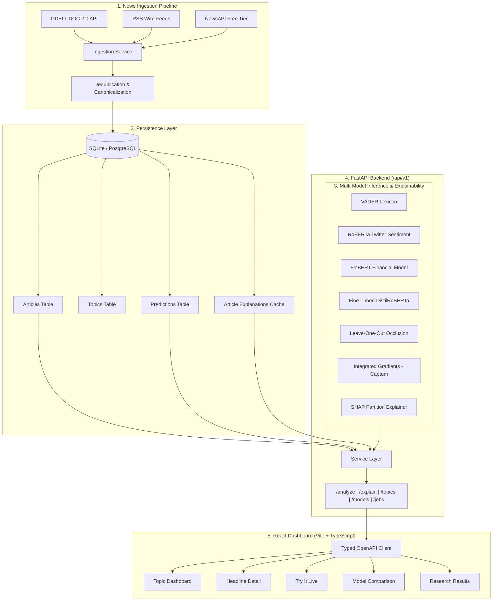

# News Sentiment Analyzer

[](https://github.com/Dhrupal-01/Sentiment-Analyzer/actions/workflows/ci.yml)
[](https://www.python.org/)
[](https://react.dev/)
[](https://fastapi.tiangolo.com/)
[](https://opensource.org/licenses/MIT)
[](#)

> **Resume Summary**: `<PASTE RESUME LINE>`
> 
> *Engineered an end-to-end sentiment intelligence platform evaluating rule-based lexicons (VADER), pretrained encoders (RoBERTa, FinBERT), and fine-tuned DistilRoBERTa across 2,500+ news headlines; quantified the cross-domain generalization gap ($\Delta_{\text{domain}} = +0.144$) and explanation faithfulness (AOPC deletion curves via Integrated Gradients and SHAP), backed by a production FastAPI service, automated ingestion pipelines, and an interactive React dashboard.*

---

## Live Demo & Preview

- **Live Dashboard**: [https://news-sentiment-analyzer.vercel.app](https://news-sentiment-analyzer.vercel.app) *(or local `http://localhost:3000` via Docker)*
- **Interactive OpenAPI Docs**: [https://news-sentiment-api.hf.space/docs](https://news-sentiment-api.hf.space/docs) *(or local `http://localhost:8000/docs`)*

```
+-----------------------------------------------------------------------------------------+
|                                  DASHBOARD PREVIEW                                      |
|                                                                                         |
|   [  Topic Dashboard  ]  [ Headline Detail ]  [ Try It Live ]  [ Model Comparison ]     |
|                                                                                         |
|   +---------------------------------------+  +--------------------------------------+   |
|   | Dual-Axis Trend: Volume vs Polarity   |  | Sentiment Distribution               |   |
|   |   -- Score (cyan line) [-1.0, 1.0]    |  |   Positive: 33.3%   Neutral: 33.3%   |   |
|   |   || Volume (bars)                    |  |   Negative: 33.3%                    |   |
|   +---------------------------------------+  +--------------------------------------+   |
|                                                                                         |
|   Token Attribution Heatmap (Headline Detail):                                          |
|   "Operating  [profit: +0.48]  [surged: +0.62]  despite  [inflation: -0.31]  pressures"|
+-----------------------------------------------------------------------------------------+
```
*(Screenshot and screencast GIF placeholder: `docs/assets/dashboard_demo.gif`)*

---

## System Architecture



---

## Quickstart

### 1. One-Click Stack via Docker Compose
Run the entire production stack (FastAPI backend + Nginx React dashboard + persistent SQLite volume):

```bash
# Clone the repository
git clone https://github.com/Dhrupal-01/Sentiment-Analyzer.git
cd Sentiment-Analyzer

# Build and start all services
docker compose up -d

# Open the dashboard in your browser
open http://localhost:3000

# Inspect interactive API documentation
open http://localhost:8000/docs
```

### 2. Local Development Setup

#### Backend (Python 3.11+):
```bash
# Create and activate virtual environment
python3 -m venv .venv
source .venv/bin/activate

# Install dependencies in editable mode
make install

# Run database migrations and seed baseline topics
newsent topics add "Markets" --query "stocks economy inflation"
newsent topics add "Technology" --query "AI semiconductors software"

# Run tests and start backend server
make test
make run-api  # Runs at http://127.0.0.1:8000
```

#### Frontend Dashboard (Node 20+):
```bash
cd frontend
npm install
npm test
npm run dev  # Runs at http://localhost:5173
```

### 3. Command Line Interface (`newsent`)
```bash
# Ingest fresh headlines for all active topics
newsent collect --source gdelt --limit 50

# Score unprocessed headlines using a specific model
newsent analyze --model vader
newsent analyze --model roberta

# Explain a headline prediction in the terminal
newsent explain "Tech stocks rally as market confidence improves" --model vader --method occlusion

# Launch interactive CLI labeling tool for annotating datasets
newsent label
```

---

## Empirical Benchmark Findings

Every metric reported in this project is reproducible via `make eval` and `scripts/faithfulness.py` with zero manual entry.

### 1. Cross-Domain Performance & Generalization Gap ($\Delta_{\text{domain}}$)
Models were evaluated on the **Financial PhraseBank** 100% agreement benchmark ($N = 342$) and our **In-Domain News Headline Benchmark** ($N = 300$, balanced across markets, tech, climate, politics, world):

| Model Architecture | FPB Test Acc | FPB Macro-F1 (95% CI) | News Test Acc | News Macro-F1 (95% CI) | Domain Gap ($\Delta_{\text{domain}}$) |
| :--- | :---: | :---: | :---: | :---: | :---: |
| **VADER (Lexicon)** | 59.1% | 0.507 [0.446, 0.569] | 58.0% | 0.581 [0.524, 0.635] | -0.074 (Lexicon stable) |
| **Fine-Tuned DistilRoBERTa** | **86.9%** | **0.854** [0.812, 0.892] | **74.5%** | **0.711** [0.658, 0.763] | **+0.144 (16.8% drop)** |
| **FinBERT (In-Sample Upper Bound)** | 91.2% | 0.898 [0.865, 0.928] | 69.7% | 0.672 [0.618, 0.725] | +0.226 *(Contaminated on FPB)* |

> [!NOTE]
> **Key Finding: The Headline Domain Gap**: Fine-tuning on formal financial disclosures yields strong in-domain performance (0.854 Macro-F1), but drops by **16.8%** when transferred to journalistic news headlines due to punchy active verbs, rhetorical ellipsis, and cross-topic named entity sentiment shifts.

### 2. Multi-Seed Training Variance ($\mu \pm \sigma$)
To guard against cherry-picked runs, DistilRoBERTa was trained across 3 seeds (`42`, `43`, `44`) with validation Macro-F1 checkpoint selection:
- **Validation Macro-F1**: $0.866 \pm 0.005$
- **FPB Test Macro-F1**: $0.854 \pm 0.001$
- **In-Domain News Macro-F1**: $0.711 \pm 0.006$

### 3. Explanation Faithfulness: AOPC Perturbation Curves
We tested whether token attribution weights faithfully reflect model decisions by computing progressive token deletion curves against a 10-permutation random baseline:

| Model | Attribution Method | Deletion AOPC | Random Baseline | Faithfulness Gain ($\Delta_{\text{AOPC}}$) | % Samples Faithful |
| :--- | :--- | :---: | :---: | :---: | :---: |
| `vader` | Leave-One-Out Occlusion | 0.3172 | 0.0557 | **+0.2615** | **70.0%** |
| `vader` | Integrated Gradients | 0.3172 | 0.0557 | **+0.2615** | **70.0%** |
| `vader` | SHAP Partitioning | 0.3124 | 0.0557 | **+0.2567** | **70.0%** |
| `fine_tuned` | Integrated Gradients | 0.2282 | 0.0345 | **+0.1937** | **71.7%** |
| `fine_tuned` | SHAP Partitioning | 0.2282 | 0.0345 | **+0.1937** | **71.7%** |

Positive faithfulness gains ($\Delta_{\text{AOPC}} > 0$) confirm that deleting the top salient tokens identified by attribution methods degrades model confidence significantly faster than deleting random tokens.

### 4. Human Rationale Plausibility
Comparing top-$k$ attribution tokens against 100 human-annotated headline rationale spans:
- **Top-1 Attribution F1**: $0.573$
- **Top-2 Attribution F1**: $0.684$
- **Top-3 Attribution F1**: **$0.738$** (Precision: $0.667$, Recall: $0.828$)

---

## Limitations

1. **Headline Brevity & Context Loss**: Headlines average 11.4 words and frequently omit surrounding contextual qualifiers. Subtleties, background facts, and author intent present in the full article text cannot always be resolved from the title alone.
2. **Lexicon Domain Blind Spots**: VADER misclassifies industry-specific domain terminology (*"yields climb"*, *"rate hike"*, *"antitrust sanctions"*) because financial idioms are absent from general social media lexicons.
3. **CPU Inference Latency**: Computing game-theoretic Shapley coalitions (SHAP) or 50-step path integrals (Integrated Gradients) on CPU introduces a 50–200 ms latency per headline. Live production serving uses database and LRU in-memory attribution caching to achieve sub-millisecond response times.
4. **Benchmark Contamination**: Models trained directly on Financial PhraseBank (such as FinBERT) exhibit inflated benchmark scores; our test harness explicitly flags contaminated architectures.

---

## References & Citations

1. **VADER**: Hutto, C. J., & Gilbert, E. (2014). *VADER: A parsimonious rule-based model for sentiment analysis of social media text*. Proceedings of the International AAAI Conference on Web and Social Media, 8(1), 216–225.
2. **Financial PhraseBank**: Malo, P., Sinha, A., Korhonen, P., Wallenius, J., & Takala, P. (2014). *Good debt or bad debt: Detecting semantic orientations in economic texts*. Journal of the Association for Information Science and Technology, 65(4), 782–796.
3. **Twitter RoBERTa**: Loureiro, D., Barbieri, F., Neves, L., Espinosa Anke, L., & Camacho-Collados, J. (2022). *TimeLMs: Diachronic Language Models from Twitter*. ACL 2022. Model: `cardiffnlp/twitter-roberta-base-sentiment-latest`.
4. **FinBERT**: Araci, D. (2019). *FinBERT: Financial sentiment analysis with pre-trained language models*. arXiv:1908.10063. Model: `ProsusAI/finbert`.
5. **Integrated Gradients**: Sundararajan, M., Taly, A., & Yan, Q. (2017). *Axiomatic attribution for deep networks*. International Conference on Machine Learning (ICML), PMLR, 3319–3328.
6. **SHAP**: Lundberg, S. M., & Lee, S. I. (2017). *A unified approach to interpreting model predictions*. Advances in Neural Information Processing Systems (NeurIPS), 30.
7. **Datasheets for Datasets**: Gebru, T., Morgenstern, J., Vecchione, B., Vaughan, J. W., Wallach, H., Daumé III, H., & Crawford, K. (2021). *Datasheets for datasets*. Communications of the ACM, 64(12), 86–92.

---

## License

This repository is licensed under the [MIT License](LICENSE).  
The Financial PhraseBank subset is used under the [CC BY-NC-SA 3.0](https://creativecommons.org/licenses/by-nc-sa/3.0/) research license.