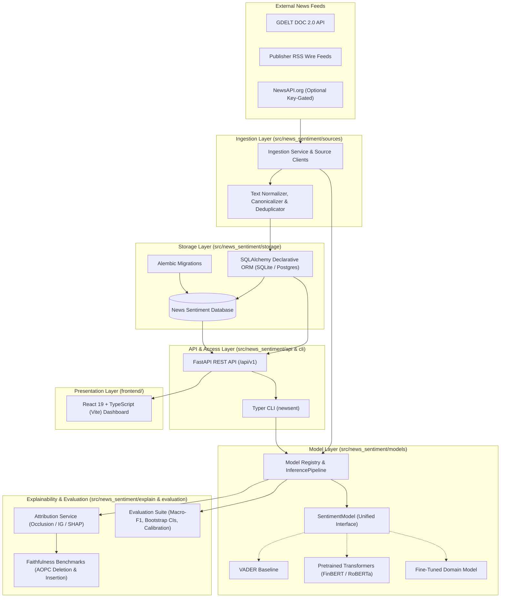
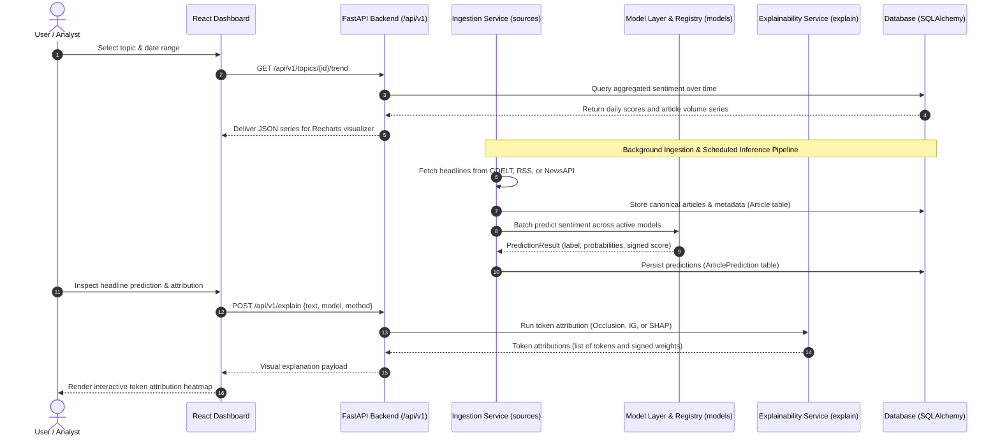

# System Architecture — News Sentiment Analyzer

## 1. Executive Summary & Research Motivation

The **News Sentiment Analyzer** is a production-grade system engineered to ingest news headlines across diverse sources, classify sentiment using multiple heterogeneous models, generate interpretable explanations for every prediction, track sentiment trajectories across topics over time, and serve predictions and analytics via a high-performance REST API and an interactive web dashboard.

### Core Research Question
> **How reliable are off-the-shelf and fine-tuned sentiment models on real news headlines, and do their explanations faithfully reflect what drives their predictions?**

News headlines exhibit distinct linguistic characteristics: concise syntax, domain-specific terminology (e.g., financial markets, geopolitical developments), irony, rhetorical questions, and dense emotional phrasing. This project empirically benchmarks:
1. **Model Reliability**: Predictive performance, calibration, and error distributions across Lexicon baselines, off-the-shelf general/financial transformers, and fine-tuned domain models.
2. **Explanation Faithfulness**: Whether attribution methods (e.g., Integrated Gradients, SHAP partition explainers, occlusion/erasure benchmarks) accurately identify the true causal drivers of model decisions or merely provide plausible post-hoc rationalizations.

---

## 2. High-Level Component Architecture

The following diagram illustrates the major architectural components, data boundaries, and subpackage relationships.



---

## 3. End-to-End Data and Inference Flow

The data flow spans news ingestion, sentiment classification, feature attribution, trend persistence, and frontend delivery.



---

## 4. Package & Module Blueprint

The codebase uses a strict `src/` layout under the root package `news_sentiment`:

| Subpackage | Responsibility | Key Classes / Modules |
| :--- | :--- | :--- |
| `news_sentiment.config` | Settings & logging | `Settings` (Pydantic Settings), `configure_logging`, `JSONFormatter`, `ConsoleFormatter` |
| `news_sentiment.sources` | Ingestion connectors | `BaseSourceClient`, `GDELTSourceClient`, `RSSSourceClient`, `NewsAPISourceClient`, `IngestionService` |
| `news_sentiment.storage` | Persistence & schema | SQLAlchemy declarative models (`Article`, `ArticlePrediction`, `ArticleAnnotation`, `Topic`, `IngestionRun`), `TopicRepository`, `ArticleRepository`, Alembic migrations |
| `news_sentiment.models` | Inference abstraction | `SentimentModel`, `PredictionResult`, `VaderModel`, `HFTransformerModel`, `InferencePipeline`, model registry |
| `news_sentiment.explain` | Explainability engine | `BaseExplainer`, `OcclusionExplainer`, `IntegratedGradientsExplainer`, `ShapPartitionExplainer`, `ExplanationService` |
| `news_sentiment.evaluation`| Empirical evaluation | Faithfulness metrics (AOPC deletion/insertion, plausibility token-F1), classification benchmarks, bootstrap CIs, contamination check |
| `news_sentiment.api` | Web service API | FastAPI routes (`/health`, `/api/v1/health`, `/api/v1/topics`, `/api/v1/analyze`, `/api/v1/explain`, `/api/v1/models`, `/api/v1/jobs/collect-and-analyze`) |
| `news_sentiment.cli` | Command-line tool | `newsent` Typer CLI: `version`, `collect`, `analyze`, `compare`, `topics`, `label`, `label-agreement`, `explain` |
| `frontend/` | Web Dashboard | React 19 + TypeScript (Vite), time-series charts, headline explorer, model comparison matrix, explanation heatmap |
| `scripts/` | Data & evaluation scripts | Reproducible scripts (`evaluate.py`, `faithfulness.py`, `train.py`, `seed_in_domain_data.py`) |

---

## 5. Model Layer & Unified Interface Design

To enable fair, rigorous empirical comparison, all sentiment models adhere to a single unified contract:

```python
class SentimentModel(ABC):
    @property
    @abstractmethod
    def name(self) -> str:
        """Unique model identifier (e.g. 'vader', 'roberta', 'finbert', 'fine_tuned')."""
        pass

    @property
    @abstractmethod
    def version(self) -> str:
        """Model or checkpoint version."""
        pass

    @abstractmethod
    def predict(self, texts: list[str]) -> list[PredictionResult]:
        """Generate sentiment predictions for a batch of texts."""
        pass

    def predict_one(self, text: str) -> PredictionResult:
        """Convenience method to predict sentiment for a single text."""
        return self.predict([text])[0]
```

### Models Benchmarked:
1. **Lexicon Baseline**: VADER (Rule-based lexical sentiment engine with compound score normalization).
2. **Pretrained General Transformer**: RoBERTa fine-tuned on tweets/social text (`cardiffnlp/twitter-roberta-base-sentiment-latest`).
3. **Pretrained Domain Transformer**: FinBERT (`ProsusAI/finbert`, domain-adapted for financial news).
4. **Custom Fine-Tuned Transformer**: DistilRoBERTa fine-tuned on financial sentence benchmarks with domain gap evaluation.

---

## 6. Explainability and Faithfulness Evaluation

Explainability answers *why* a model made a specific prediction. The evaluation pipeline answers *whether that explanation is faithful*.

1. **Attribution Methods**:
   - **Leave-One-Out Occlusion**: Token masking with negation-aware delta attribution.
   - **Integrated Gradients**: Path-integral gradient baselines via Captum for transformer embeddings.
   - **SHAP Partition Explainer**: Game-theoretic Shapley value estimation using hierarchical text partitioning.
2. **Faithfulness Benchmarking**:
   - **Progressive Deletion Curves (AOPC)**: If top attributed tokens are causally important, deleting them progressively causes rapid decay in model confidence. Evaluated against a 10-permutation random-token baseline.
   - **Progressive Insertion Curves**: Verifies sufficiency when restoring top tokens into neutral baselines.
   - **Plausibility Agreement**: Token-level F1 comparing model attributions with human rationale annotations.

---

## 7. Serving, Deployment, and Quality Assurance

- **API Layer**: FastAPI application exposing versioned `/api/v1` asynchronous endpoints, in-memory CPU model preloading at lifespan startup, and strict Pydantic payload validation.
- **Frontend Layer**: React 19 + TypeScript powered by Vite, providing responsive charts for temporal topic sentiment and interactive saliency heatmaps.
- **Continuous Integration**: GitHub Actions executing on every pull request and push:
  - Linting & formatting check with `ruff`
  - Strict type checking with `mypy` on `src/news_sentiment`
  - Fast test execution and minimum coverage check with `pytest` and `pytest-cov` (target $\ge 80\%$)
- **Docker Deployment**: Multi-stage Dockerfile packaging the FastAPI application with CPU-only torch, Uvicorn, and docker-compose for the full local stack.
