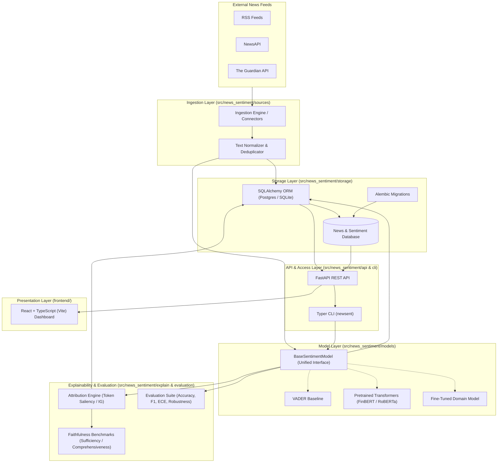
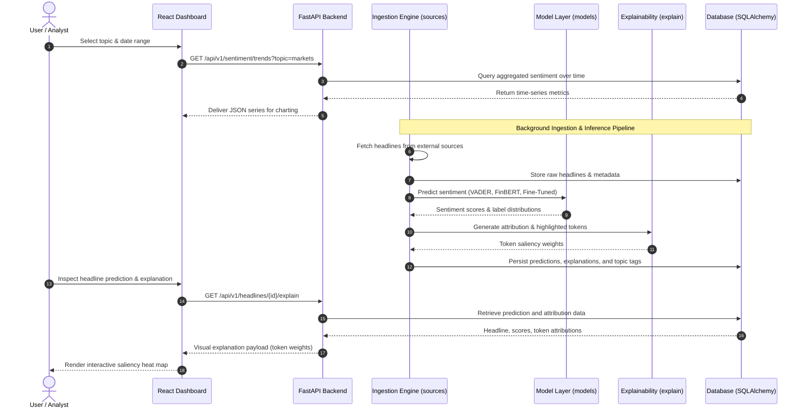

# System Architecture — News Sentiment Analyzer

## 1. Executive Summary & Research Motivation

The **News Sentiment Analyzer** is a production-grade system engineered to ingest news headlines across diverse sources, classify sentiment using multiple heterogeneous models, generate interpretable explanations for every prediction, track sentiment trajectories across topics over time, and serve predictions and analytics via a high-performance REST API and an interactive web dashboard.

### Core Research Question
> **How reliable are off-the-shelf and fine-tuned sentiment models on real news headlines, and do their explanations faithfully reflect what drives their predictions?**

News headlines exhibit distinct linguistic characteristics: concise syntax, domain-specific terminology (e.g., financial markets, geopolitical developments), irony, rhetorical questions, and dense emotional phrasing. This project empirically benchmarks:
1. **Model Reliability**: Predictive performance, calibration, and error distributions across Lexicon baselines, off-the-shelf general/financial transformers, and fine-tuned domain models.
2. **Explanation Faithfulness**: Whether attribution methods (e.g., Integrated Gradients, token saliency, erasure benchmarks) accurately identify the true causal drivers of model decisions or merely provide plausible post-hoc rationalizations.

---

## 2. High-Level Component Architecture

The following diagram illustrates the major architectural components, data boundaries, and subpackage relationships.



---

## 3. End-to-End Data and Inference Flow

The data flow spans news ingestion, sentiment classification, feature attribution, trend persistence, and frontend delivery.



---

## 4. Package & Module Blueprint

The codebase uses a strict `src/` layout under the root package `news_sentiment`:

| Subpackage | Responsibility | Key Classes / Responsibilities |
| :--- | :--- | :--- |
| `news_sentiment.config` | Settings & logging | `Settings` (Pydantic Settings), `configure_logging`, `JSONFormatter`, `ConsoleFormatter` |
| `news_sentiment.sources` | Ingestion connectors | `BaseSourceClient`, RSS parser, NewsAPI client, deduplication, headline cleaning |
| `news_sentiment.storage` | Persistence & schema | SQLAlchemy declarative models (`Headline`, `SentimentResult`, `Explanation`, `Topic`), Alembic migrations |
| `news_sentiment.models` | Inference abstraction | `BaseSentimentModel`, `VaderModel`, `TransformerSentimentModel`, `FineTunedSentimentModel` |
| `news_sentiment.explain` | Explainability engine | `BaseExplainer`, `IntegratedGradientsExplainer`, token saliency scoring, rationalization tests |
| `news_sentiment.evaluation`| Empirical evaluation | Faithfulness metrics (erasure, comprehensiveness, sufficiency), classification benchmarks, calibration |
| `news_sentiment.api` | Web service API | FastAPI routes (`/health`, `/headlines`, `/sentiment`, `/explain`, `/trends`), OpenAPI documentation |
| `news_sentiment.cli` | Command-line tool | `newsent` Typer CLI: `version`, `ingest`, `predict`, `evaluate`, `serve` |
| `frontend/` | Web Dashboard | React + TypeScript (Vite), time-series charts, headline explorer, explanation inspector |
| `scripts/` | Data & evaluation scripts | Reproducible scripts generating all experimental figures and benchmark metrics |

---

## 5. Model Layer & Unified Interface Design

To enable fair, rigorous empirical comparison, all sentiment models adhere to a single unified contract:

```python
class BaseSentimentModel(ABC):
    @abstractmethod
    def predict(self, text: str) -> SentimentOutput:
        """Return probabilities, discrete sentiment label, and inference metadata."""
        pass

    @abstractmethod
    def batch_predict(self, texts: list[str]) -> list[SentimentOutput]:
        """Vectorized or batched inference."""
        pass
```

### Models Benchmarked:
1. **Lexicon Baseline**: VADER (Rule-based lexical sentiment engine).
2. **Pretrained General Transformer**: RoBERTa fine-tuned on sentiment (e.g., `cardiffnlp/twitter-roberta-base-sentiment-latest`).
3. **Pretrained Domain Transformer**: FinBERT (Domain-adapted for financial news and market headlines).
4. **Custom Fine-Tuned Transformer**: Domain-adapted on annotated news headline benchmarks.

---

## 6. Explainability and Faithfulness Evaluation

Explainability answers *why* a model made a specific prediction. The evaluation pipeline answers *whether that explanation is faithful*.

1. **Attribution Methods**:
   - Token-level gradient-based saliency and Integrated Gradients.
   - Attention-weight analysis with appropriate baselines.
   - Perturbation / Occlusion-based feature importance.
2. **Faithfulness Benchmarking**:
   - **Comprehensiveness**: If top attributed tokens are removed, does model confidence drop substantially?
   - **Sufficiency**: If only top attributed tokens are retained, is model confidence preserved?
   - **Randomization Tests**: Sanity checks ensuring attributions depend on model parameters rather than arbitrary heuristics.

---

## 7. Serving, Deployment, and Quality Assurance

- **API Layer**: FastAPI application exposing asynchronous endpoints, automatic schema generation, and strict Pydantic payload validation.
- **Frontend Layer**: React + TypeScript powered by Vite, providing responsive charts for temporal topic sentiment and interactive saliency heatmaps.
- **Continuous Integration**: GitHub Actions executing on every pull request and push:
  - Linting & formatting check with `ruff`
  - Strict type checking with `mypy` on `src/news_sentiment`
  - Test execution and minimum coverage check with `pytest` and `pytest-cov`
- **Docker Deployment**: Multi-stage Dockerfile packaging the FastAPI application with production Uvicorn workers and static asset serving.
